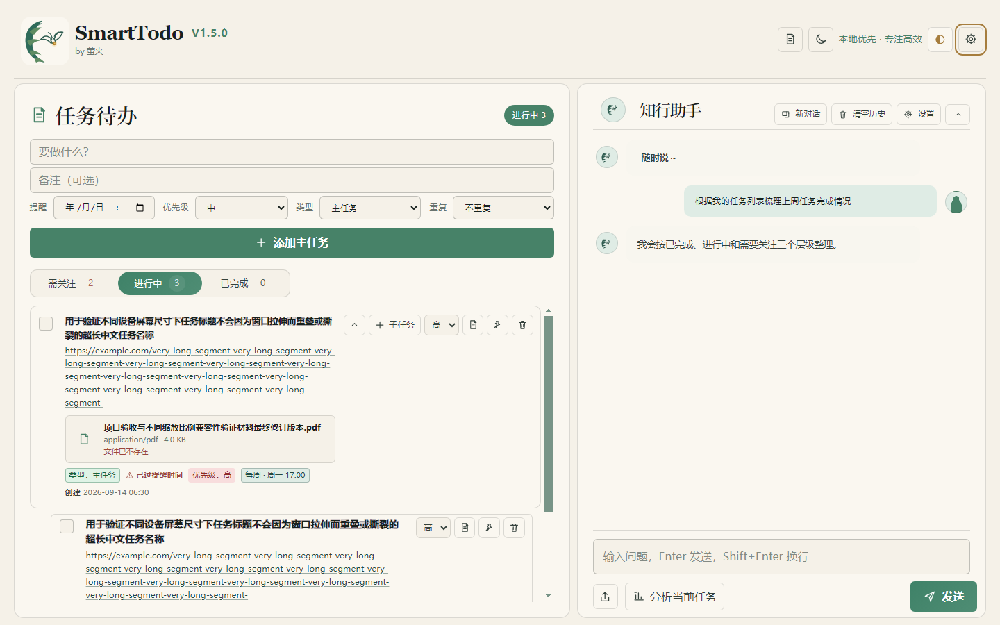
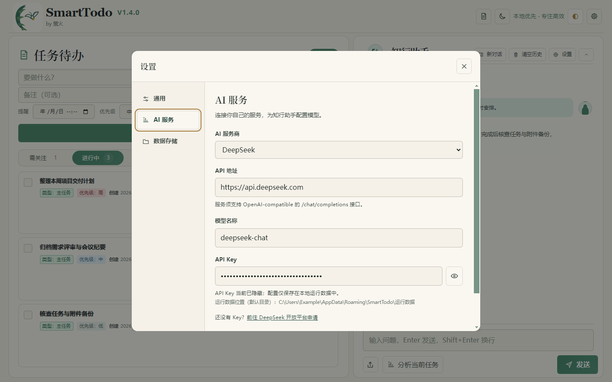
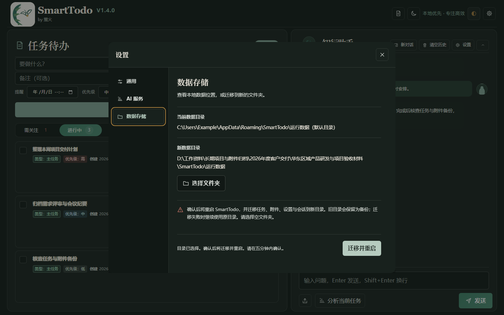
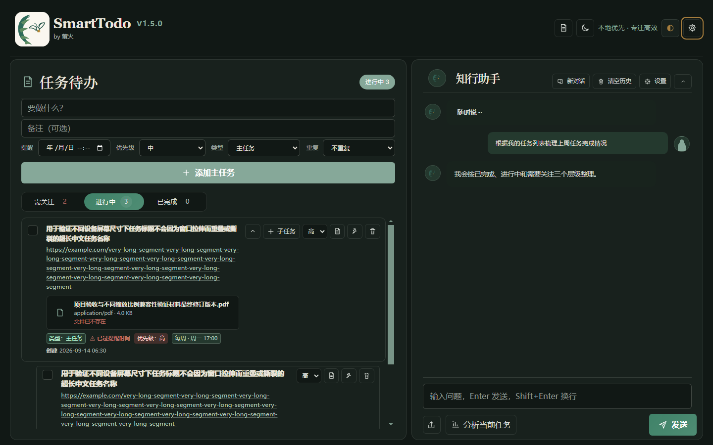

<p align="center">
  
</p>

<h1 align="center">SmartTodo</h1>

<p align="center"><b>本地优先、低调简洁的 Windows 桌面任务管理器</b></p>

<p align="center">最后更新: 2026-10-16 · 对应版本: v1.5.0</p>

<p align="center">
  
  
  
  
  
</p>

<p align="center">
  <a href="https://github.com/whight-autumn/SmartTodo/releases/latest"><b>下载 Windows 便携版</b></a>
  ·
  <a href="release/版本迭代说明.md">查看版本迭代</a>
</p>



SmartTodo 把主任务、子任务、提醒、附件和可选 AI 助手放在同一个本地工作台中。任务、会话、设置与 API Key 均保存在本机；不配置 AI、甚至断网时，任务管理仍可完整使用。

当前源码版本：V1.5.0（2026-10-16，Windows x64 便携版已正式发布）。本版移除主窗口顶部突兀的 Windows 默认标题栏，以透明原生窗口按钮和主题同步融入既有现代新中式界面；宽屏品牌与工具按完整 114px 顶栏居中，窄屏保留 36px 系统按钮安全区。发布信息见 [`release/V1.5.0/版本说明.txt`](release/V1.5.0/版本说明.txt)。

## 三分钟上手

### 1. 启动

1. 从 [GitHub Releases](https://github.com/whight-autumn/SmartTodo/releases/latest) 下载 V1.5.0 Windows x64 便携版，双击即可运行，无需安装。
2. 如果旧版本仍在运行，请先从系统托盘完全退出。
3. 本项目未进行商业代码签名，首次运行时 Windows SmartScreen 可能提示“未知发布者”；请核对发布页 SHA-256 后继续。

从旧版本升级时，沿用 V1.3.1 引入的历史运行目录兼容逻辑；自定义目录启动时不会迁移到未使用的默认目录。

### 2. 创建一次性任务

在“任务待办”顶部输入任务名称，可按需填写备注、提醒时间和优先级。“重复”保持“不重复”，然后点击“添加主任务”。

- 需要拆分步骤时，点击任务右侧的“子任务”。
- 点击图钉可置顶重要事项；优先级和置顶互不冲突。
- 使用“需关注／进行中／已完成”快速切换当前视图。
- 点击任务右侧的备注按钮，可继续编辑备注、链接和附件。

### 3. 创建重复任务

在原有任务添加区把“重复”改为每天、每周、每月或每年。重复任务必须设置首次提醒时间，SmartTodo 会从中保留后续周期所需的日期与时分。

| 重复方式 | 新周期开始时间 | 后续提醒依据 |
| --- | --- | --- |
| 每天 | 每天 04:00 | 首次提醒的时、分 |
| 每周 | 每周一 04:00 | 首次提醒所在星期与时、分 |
| 每月 | 每月 1 日 04:00 | 首次提醒的日期与时、分 |
| 每年 | 每年 1 月 1 日 04:00 | 首次提醒的月、日、时、分 |

若上一周期仍未完成，SmartTodo 会在新周期任务下增加“上期未完成”子任务；离线错过多个周期时会合并提示，避免列表无限增长。月末日期和闰日会自动采用有效日期，并在条件恢复时回到原始锚点。

### 4. 使用桌面任务笺

点击主界面右上角的任务笺按钮，可显示或收起桌面右侧的小窗。任务笺最多展示 5 项未完成任务，优先顺序为：

```text
已逾期 → 24 小时内到期 → 置顶 → 高优先级 → 其余任务
```

任务笺支持直接完成任务和打开主界面；它不置顶、不抢占键盘焦点，也不能创建、编辑或删除任务。位置与可见性会被记住，主题和亮度会与主界面同步。

### 5. 使用知行助手（可选）

点击全局齿轮进入设置中心的“常规”页；点击“知行助手”的设置进入同一个中心的“AI”页。中心统一提供常规、AI、存储三个模块，各模块分别操作，没有全局保存按钮。

AI 页保留 DeepSeek、OpenAI 和自定义 OpenAI-compatible 服务，填写 API 地址、模型与 API Key 后点击保存即可用于对话与任务分析。地址支持 HTTP/HTTPS，尾部斜杠和字段空白会规范化；保存只验证本地字段格式，不联网验证 API Key。Key 默认遮蔽，可切换显示，关闭设置后重新遮蔽。配置以 `ai_provider_config` 和兼容的 `deepseek_api_key` 键保存在当前运行目录的 Chromium localStorage 中；遮蔽不等于加密，请勿分享运行数据。

常规页的 Windows 开机自启动立即写入系统并读取实际状态，Windows 禁用的启动项不会显示成已启用。开机启动使用 `--hidden`，主窗口隐藏且不抢焦点，应用驻留托盘；手动启动正常显示主窗口，任务笺仍遵循已有可见性偏好。其他平台显示不可用。该行为已在 Electron API 边界测试，未改写测试主机的真实启动项。

自启动与迁移重启共用启动路径规则：便携模式使用 `PORTABLE_EXECUTABLE_FILE` 指向的持久外层 EXE；普通安装包使用当前 EXE；开发模式使用 Electron 加应用目录参数。登录启动在应用参数后加 `--hidden`；由可见设置页发起的数据迁移始终以可见主窗口重启，便于查看结果。无效便携路径会拒绝操作，避免登记退出后消失的临时解压 EXE。

## 界面导览

### V1.4 设置中心

“通用”“AI 服务”“数据存储”共享一个设置中心，各模块提供自己的操作。下方是生产渲染器在隔离测试配置中验证的 1440×900 亮色 AI 与深色存储界面：API Key 使用虚构值并保持遮蔽，路径为演示数据。长路径可换行，内容独立滚动，操作可通过滚动到达。

<table>
  <tr>
    <td width="50%"></td>
    <td width="50%"></td>
  </tr>
  <tr>
    <td align="center">AI 服务 · 亮色</td>
    <td align="center">数据存储 · 深色</td>
  </tr>
</table>

### 深浅双主题

暖纸、竹青、漆夜与朱砂构成现代新中式视觉体系。主题、亮度和减少动态效果设置不会改变任务数据。

<table>
  <tr>
    <td width="50%"></td>
    <td width="50%"></td>
  </tr>
  <tr>
    <td align="center">文房案台 · 亮色</td>
    <td align="center">漆夜流萤 · 暗色</td>
  </tr>
</table>

### 响应式工作台

主界面覆盖 1366×768 至 2560×1440、窄窗口以及 Windows 125%／150% 缩放。长标题、长链接、长文件名和任务操作区会自然换行，不因窗口拉伸而交叉或撕裂。

<p align="center">
  
</p>

### 半透明桌面任务笺

任务笺以轻量、半透明的方式停靠在桌面右侧，让近期任务随时可见，同时避免覆盖日常工作窗口。

<p align="center">
  
</p>

## 核心能力

- 主任务／子任务、一次性或每天／每周／每月／每年重复、提醒、高中低优先级、置顶、折叠、完成与撤销。
- 重复任务采用本地 04:00 周期刷新、提醒锚点投影、未完成承接与多期离线合并。
- 可重复编辑备注；安全打开 HTTP/HTTPS 链接；每项任务最多 10 个附件，单个不超过 20MB。
- “需关注／进行中／已完成”筛选；完成任务保留 15 天后自动清理。
- DeepSeek、OpenAI 与自定义 OpenAI-compatible 服务；支持流式对话、会话管理和任务分析。
- 深浅主题、75%–125% 亮度、系统通知、托盘常驻、单实例运行和减少动态效果模式。
- 点击系统任务提醒会恢复并聚焦主窗口，便于立即处理到期任务。
- 桌面任务笺支持五任务排序、完成同步、位置记忆、显示器变化回收和持久化失败回滚。
- 统一三模块设置、Windows 隐藏启动及完整运行数据目录的安全迁移。

## 版本迭代

| 版本 | 日期 | 迭代重点 |
| --- | --- | --- |
| V1.0.7 | 2026-09-15 | 修复附件状态显示，完善完成、删除与孤立附件清理。 |
| V1.2.0 | 2026-09-21 | 完成现代新中式界面重构，引入响应式工作台与桌面任务笺。 |
| V1.2.1 | 2026-09-21 | 修复任务操作区、知行助手、顶部工具区和任务笺交互错位。 |
| V1.2.2 | 2026-09-22 | 修复时间输入黑屏与亮度悬停断层，增强操作反馈和可访问性。 |
| V1.3.0 | 2026-09-22 | 新增周期任务、04:00 刷新、提醒锚点和未完成任务承接。 |
| V1.3.1 | 2026-09-22 | 统一 SmartTodo 品牌、Windows 包名与运行数据目录，兼容迁移历史数据。 |
| V1.4.0 | 2026-10-13 | 打包前源码审阅：统一设置中心、Windows 开机自启动、运行数据目录迁移。 |
| V1.4.1 | 2026-10-13 | 正式发布 V1.4 功能；点击系统任务提醒可恢复并聚焦主窗口。 |
| V1.4.2 | 2026-10-13 | 修复 Electron 启动项参数回读缺失导致自启动开关错误回弹。 |
| V1.5.0 | 2026-10-16 | 隐藏 Windows 默认标题栏，以主题同步的原生窗口控件融入应用界面，并优化顶部品牌与工具的比例和居中关系。 |

完整演进背景、兼容策略和各版本详细改动见 [`release/版本迭代说明.md`](release/版本迭代说明.md)；面向开发者的变更记录见 [`CHANGELOG.md`](CHANGELOG.md)。

## 数据与升级兼容

默认运行数据目录（存储页显示实际当前路径和默认／自定义状态）：

```text
%APPDATA%\SmartTodo\运行数据
```

任务附件目录：

```text
%APPDATA%\SmartTodo\运行数据\task-attachments\<任务ID>\
```

V1.5.0 不改变既有任务、草稿、主题、AI 配置、会话、localStorage 键名和受管附件结构。默认目录的历史兼容规则由 V1.3.1 引入：优先从 `%APPDATA%\智能任务管家\运行数据` 迁移，若不存在则兼容更早的 `%APPDATA%\smart-assistant`；默认目录已有 Chromium Local Storage 时不覆盖。升级前建议备份整个“运行数据”目录，请勿分发其中的 API Key。

存储页的“数据目录”是完整 Electron 运行配置目录，包含 Chromium Local Storage 中的任务、草稿、AI 配置、会话和界面设置，以及 `task-attachments`、`widget-preferences.json` 等运行文件；不是附件目录或 EXE 所在目录。迁移不会移动可执行文件，也不提供云同步或自动清理旧备份。

通过系统原生目录选择器选定空目录后，点击迁移会先刷新 Chromium 存储及任务笺偏好，保存请求并重启。渲染器只提交一次性目录选择凭证，不能直接提交路径。主进程在请求和下次启动时校验：拒绝根目录、用户主目录、与源重合或相互包含、会包围应用目录或引导配置的目录、非空目标及符号链接／junction；同时检查访问权限。

重启后、Chromium 打开配置前，程序将整个目录复制到临时位置，比较源目录与副本的逐文件相对路径、大小和 SHA-256 清单。校验通过后提升副本，先记录恢复日志并把原目录保留为同级 `原目录名.backup-YYYYMMDD-HHMMSS`，再原子保存新路径为活动目录。引导文件 `%APPDATA%\SmartTodo\bootstrap.json` 留在运行目录之外。

复制、校验或备份失败时不激活目标，继续使用原数据；若恢复原路径失败，可使用校验一致的原数据备份。中断恢复必须验证原数据清单并先持久化恢复路径；找不到可靠原数据或无法保存恢复状态时，启动会停止以免创建空配置。已提升但未激活的副本可能保留，不会覆盖无关目录。迁移结果在下次启动只提示一次。失败后请检查目标是否为空及路径权限，必要时恢复引导目录写权限，再重新选择目录；请保留原目录或时间戳备份。

引导文件缺失或损坏时，只能回退到通过安全校验的默认目录；默认目录为 junction、符号链接或普通文件等不安全路径时，会在打开配置或创建存储前停止启动。安全的自定义活动目录不受未使用的默认目录影响。存储页保留迁移结果详情：成功显示当前目录与旧备份目录，失败显示有限类别的恢复指引，备份恢复明确显示当前恢复路径，保留暂存／回滚副本时显示安全提示；消费结果写入失败仍可在下次启动重试。

提醒和周期刷新由本地应用进程执行。点击系统任务提醒会恢复并聚焦主窗口；SmartTodo 完全退出后不会在后台发送通知，重新启动时会补做周期刷新，并为当前未提醒的到期周期补发一次提醒。

## 从源码运行

需要 Node.js 18 或更高版本。

```powershell
npm install
npm start
```

### 测试

```powershell
# 纯逻辑、IPC、安全边界与静态契约
npm test

# 主界面行为、响应式矩阵、真实双窗口任务笺
npm run test:ui
```

V1.5.0 的 `npm test` 共 312 项：310 项通过、0 项失败、2 项因当前 Windows 环境无法创建测试用文件符号链接而跳过。测试覆盖运行目录校验、复制／SHA-256 清单、备份失败与中断恢复、缺失自定义目录保护、应用目录边界、Windows 标题栏覆盖与主题同步、顶部布局与键盘顺序、提醒点击唤起、设置 IPC／一次性凭证、既有任务与附件。

Task 6 的真实 Electron 测试已通过：设置中心在 11 组尺寸／缩放、双主题下共 22 组场景（1366×768 至 2560×1440、480／639／640px 窄窗、125%／150% 缩放），验证长路径换行、零横向溢出、固定标题、可滚动内容与可达操作；并验证双入口、方向键／Home／End、ARIA 选中状态、焦点还原、Esc、Key 遮蔽和失败恢复。原工作台 8 组布局及任务笺三档缩放也通过。跨进程重启测试使用真实临时文件与生产迁移代码，但 Electron／OS 边界使用测试替身；未测试真实 Windows 自启动、用户数据或打包二进制。已记录既有开发 CSP 警告及任务笺测试中缺少部分 fixture IPC handler 的问题，没有将这些日志称为无警告通过。

### 构建

根入口、`src/` 主进程支持层与 preload、renderer 和 assets 均已纳入显式打包清单：

```powershell
npm run dist
```

GitHub Release 已发布 `SmartTodo-1.5.0.exe`：74,064,756 字节（70.63 MiB），SHA-256 为 `78147CD2B2C1F8337BFFD0A99D7F8E069507A1ED262609D92E7D8DAD7F9E0245`。当前产物未签名；EXE 由 `.gitignore` 排除，通过 GitHub Release 分发。

### 项目结构

```text
SmartTodo/
├── AGENTS.md / ENGINEERING_CHARTER.md # 协作入口与工程规则正本
├── main.js                         # 薄主入口：窗口、托盘、通知与生命周期装配
├── src/
│   ├── main/                       # 主进程支持层（路径、迁移、启动、设置、附件、任务笺）
│   └── preload/                    # 主窗口与任务笺的最小隔离桥接
├── renderer/
│   ├── index.html / app.js         # 主界面与业务逻辑
│   ├── settings-controller.js      # 三模块设置、焦点、状态与安全凭证
│   ├── widget.html / widget.js     # 桌面任务笺
│   ├── recurrence-model.js         # 04:00 周期、日历投影与提醒指纹
│   ├── task-model.js               # 任务规范化、周期刷新与筛选
│   └── styles/                     # 令牌、布局、组件与动效
├── tests/                          # 单元与真实 Electron 窗口测试
├── docs/
│   ├── 01_design/ / 02_plan/       # 当前设计与执行计划
│   ├── reference/                  # 当前文件职责说明
│   ├── images/                     # README 当前界面截图
│   └── 99_archive/                 # 历史设计、报告与 UI 证据
├── assets/                         # 品牌源文件、字体与应用图标
├── PROJECT_TREE.md                 # 九板块架构、链路、数据流与维护入口
├── tests/ / scripts/               # 正式测试与可复用品牌构建脚本
└── release/                        # 版本迭代说明与各版本发布记录
```

完整架构与二次开发入口见 [`PROJECT_TREE.md`](PROJECT_TREE.md)，逐文件职责见 [`docs/reference/文件说明.md`](docs/reference/文件说明.md)。

## 安全边界

- 主窗口与任务笺均启用 `contextIsolation: true`、关闭 `nodeIntegration`。
- preload 不暴露 `ipcRenderer`、文件系统、任意通道或任意绝对路径导入能力。
- 设置 IPC 只接受当前主窗口、严格 payload 与短时一次性选择凭证；任务笺不能更改设置或迁移目录。
- 任务笺只接收允许展示的任务字段，只能请求完成、隐藏自身或打开主界面。
- 附件使用固定 IPC、随机磁盘名、规范路径校验和单调准备／持久化／提交事务。
- 备注先按纯文本转义，仅允许用户主动通过系统浏览器打开 HTTP/HTTPS 链接。

## License

[MIT](LICENSE) · by 萤火
